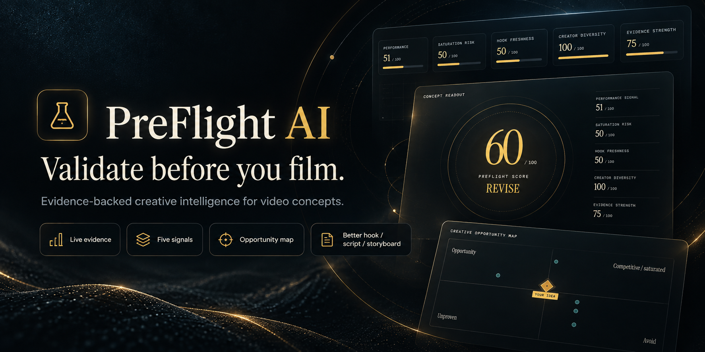
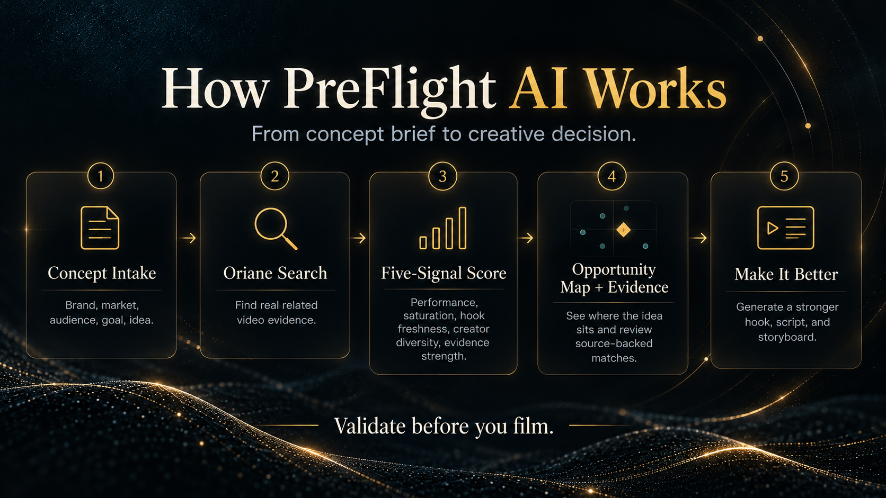
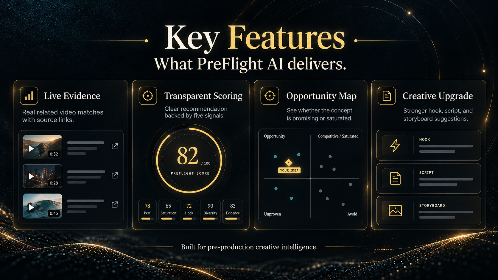
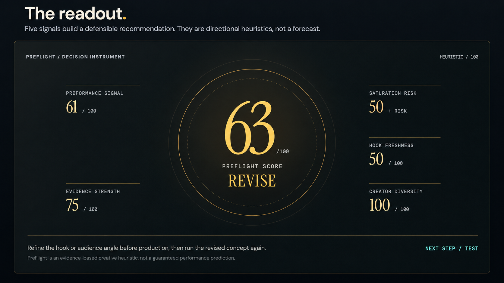
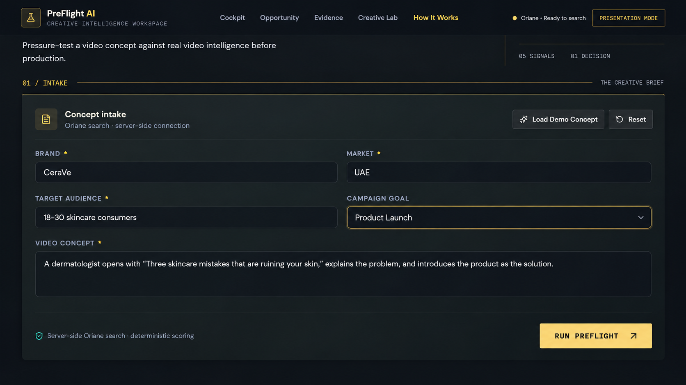
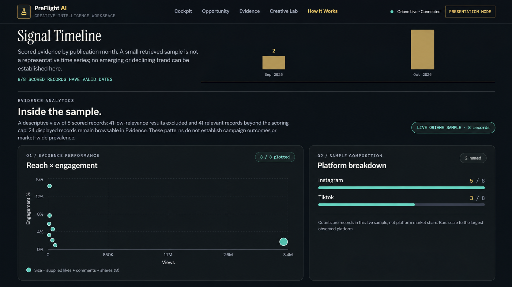
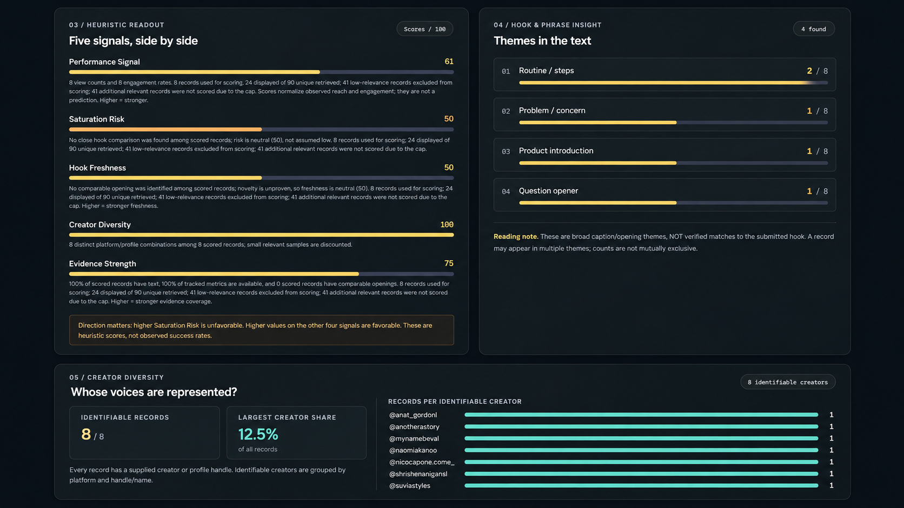
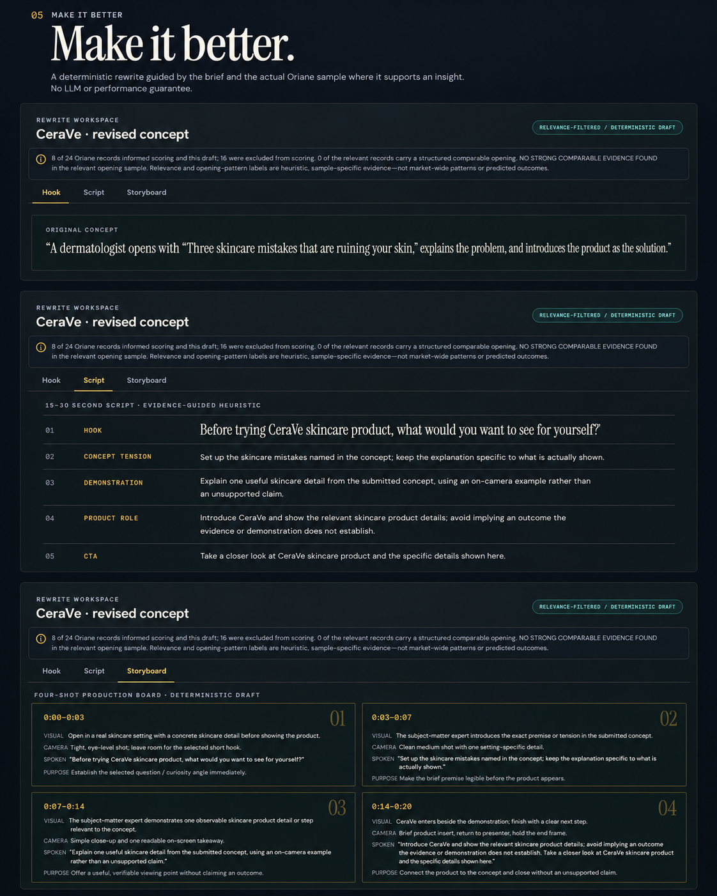

# PreFlight AI

<p align="center">
  
</p>

<p align="center">
  <strong>Validate before you film.</strong><br>
  Pre-production creative intelligence powered by real Oriane video evidence.
</p>

<p align="center">
  <a href="https://preflight-ai.replit.app/">Live Demo</a>
</p>

PreFlight AI helps brands, agencies, and creative teams evaluate a video concept **before production**. It searches real video evidence through Oriane, turns the retrieved signals into a transparent creative assessment, and helps the user decide whether to **GO, REVISE, or AVOID** before spending time and budget on filming.

> **Important:** PreFlight AI is an evidence-backed creative decision-support system. It does **not** guarantee or predict campaign performance.

## Why PreFlight?

Most creative analytics tools start after a video has already been published. PreFlight moves the decision earlier.

Instead of asking:

> “How did this video perform?”

PreFlight asks:

> **“Should we produce this idea, and how can we make it stronger before filming?”**

## How PreFlight Works

<p align="center">
  
</p>

The workflow is simple:

**Concept → Oriane Evidence → Five Signals → Creative Decision → Improved Concept**

1. Enter a brand, market, audience, campaign goal, and video concept.
2. PreFlight searches Oriane server-side for relevant indexed videos.
3. The retrieved evidence is evaluated across five transparent signals.
4. The concept receives a PreFlight Score and a directional recommendation.
5. The user can inspect the evidence, explore the opportunity map, and improve the concept before production.

## Key Features

<p align="center">
  
</p>

### PreFlight Score

A transparent 0–100 heuristic score with a clear recommendation:

- **GO**
- **REVISE**
- **AVOID**

### Five Creative Signals

PreFlight evaluates:

- **Performance Signal** — observed reach and engagement in the retrieved evidence
- **Saturation Risk** — how crowded comparable creative patterns appear in the sample
- **Hook Freshness** — whether similar openings are repeatedly observed
- **Creator Diversity** — how broadly the evidence is distributed across identifiable creators
- **Evidence Strength** — sample size, field coverage, and availability of usable creative evidence

### Creative Opportunity Map

An interactive visual instrument that places the submitted idea against observed performance and saturation signals, helping the user see where the concept sits before production.

### Evidence Analytics

The application exposes the retrieved Oriane sample through interactive visualizations such as:

- Reach vs. engagement
- Platform composition
- Creator diversity
- Recurring content-angle signals
- Time-based sample views

### Evidence Cards

Each evidence card can include:

- Creator / profile
- Platform
- Views
- Likes
- Comments
- Shares
- Engagement
- Publish date
- Caption or transcript excerpt
- Match explanation
- Source details
- Original-video link when the source platform URL is available

### Make It Better

PreFlight turns the analysis into a usable creative revision through:

- **Hook**
- **Script**
- **Storyboard**

The output is evidence-guided and explicitly presented as a creative recommendation, not a guaranteed winner.

### Presentation Mode

A polished presentation view designed for live demos, pitches, and stakeholder reviews.

## Product Visuals

The overview illustrations in `assets/` explain the concept and workflow. The **actual application screenshots** live in `assets/screenshots/` and are displayed above. Interface output varies by brief and source data.

## Actual Application Screenshots

Explore the implemented application, from creative brief to evidence-backed decision and production-ready creative directions.

> These are **real screenshots of PreFlight AI**, not concept mockups. The example is CeraVe skincare; results depend on the retrieved sample and availability of the Oriane API.

### Decision Readout

<p align="center">
  
</p>

### Creative Brief

<p align="center">
  
</p>

### Oriane Evidence

<p align="center">
  
</p>

### Creative Rewrite

<p align="center">
  
</p>

### Storyboard

<p align="center">
  
</p>

**[View all 10 screenshots, including the search trace, signal analysis, and script →](docs/SCREENSHOTS.md)**

## Tech Stack

- React
- TypeScript
- Vite
- Node.js / Express
- Oriane API
- Recharts
- Framer Motion
- pnpm workspaces

## Architecture

```text
User Concept
    ↓
PreFlight React UI
    ↓
Server-side API route
    ↓
Oriane Search API
    ↓
Normalized video evidence
    ↓
Deterministic scoring + evidence analysis
    ↓
PreFlight Score / Opportunity Map / Evidence / Creative Rewrite
```

The Oriane API key is kept server-side and is never intentionally exposed to the browser.

## Environment Variables

Create your own local environment configuration. Do not commit secrets.

```text
ORIANE_API_KEY=your_oriane_api_key_here
```

The Replit workspace may also use environment-specific values such as `PORT` and `BASE_PATH`.

## Security

API credentials are expected to remain server-side. This public repository intentionally excludes local `.env` files, Git history from the original workspace export, Replit caches, installed dependencies, and build output.

## Project Structure

- `artifacts/preflight-ai` — main React application
- `artifacts/api-server` — server-side API and Oriane integration
- `lib` — shared workspace packages
- `scripts` — workspace scripts
- `assets` — overview illustrations and original application screenshots
- `docs/SCREENSHOTS.md` — complete 10-image screenshot gallery

## Hackathon

PreFlight AI was built during the **Oriane × Replit hackathon** as a standalone product concept for the video economy, with Oriane video intelligence at the core of the workflow.

## Live Demo

**PreFlight AI:** https://preflight-ai.replit.app/

---

**PreFlight AI — Validate before you film.**
